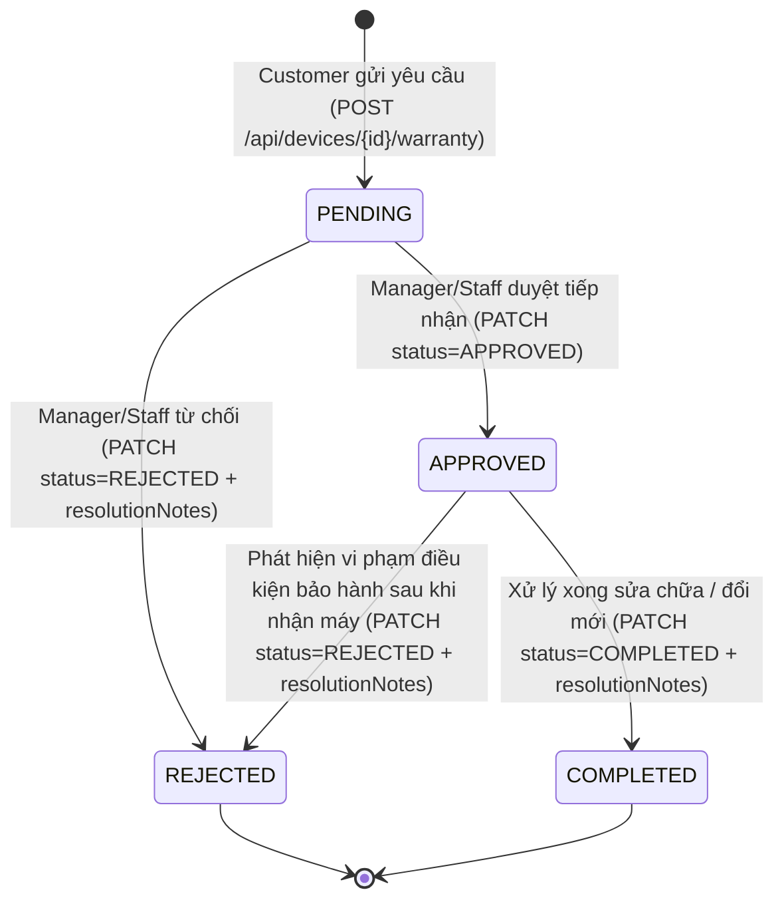

# API Contract: Dịch vụ Bảo hành Phần cứng (Hardware Warranty Service)

Tài liệu đặc tả hợp đồng API (API Contract) chuẩn hóa giữa **Frontend (Web/Mobile)** và **Backend** cho toàn bộ phân hệ **Bảo hành phần cứng thiết bị LED (Hardware Device Warranty)** trong hệ sinh thái Lumintra.

---

## 1. Thông tin chung (General Information)

- **Base URL**: `http://localhost:8080` (hoặc domain gateway môi trường deployment)
- **Chuẩn dữ liệu**: `application/json; charset=UTF-8`
- **Xác thực (Authentication)**:
  - Header: `Authorization: Bearer <access_token>` (JWT Token)
  - Phân quyền (RBAC):
    - Khách hàng: Role `CUSTOMER`
    - Quản lý / Nhân viên: Role `STAFF`, `MANAGER`, `ADMIN`
- **Quy ước phản hồi chuẩn (ApiResponse Envelope)**:
  ```json
  {
    "code": "SUCCESS",
    "message": "Operation completed successfully.",
    "status": 200,
    "timestamp": "2026-11-17T14:00:00.000Z",
    "traceId": "trace-uuid-or-hex",
    "data": { ... }
  }
  ```
- **Quy ước lỗi chuẩn (ErrorResponse Envelope)**:
  ```json
  {
    "code": "ERROR_CODE_NAME",
    "message": "Mô tả chi tiết nguyên nhân lỗi.",
    "status": 400,
    "timestamp": "2026-11-17T14:00:00.000Z",
    "traceId": "trace-uuid-or-hex",
    "errors": null
  }
  ```

---

## 2. Định nghĩa Enums & Trạng thái (Core Enums)

### 2.1. `WarrantyStatus` (Tình trạng hiệu lực bảo hành thiết bị)
Đại diện cho trạng thái bảo hành 180 ngày của phần cứng thiết bị (`LED_INSTANCE`):

| Giá trị | Mô tả nghiệp vụ |
| :--- | :--- |
| `NOT_ACTIVATED` | Thiết bị chưa được kích hoạt/gắn quyền sở hữu với tài khoản khách hàng qua quét mã QR. |
| `ACTIVE` | Thiết bị đang trong thời hạn bảo hành phần cứng 180 ngày kể từ ngày kích hoạt (`activatedAt`). |
| `EXPIRED` | Thiết bị đã hết hạn bảo hành phần cứng (vượt quá 180 ngày kể từ ngày kích hoạt theo `BR-FL5-02`). |

### 2.2. `WarrantyTicketStatus` (Trạng thái phiếu bảo hành)
Đại diện cho vòng đời của một phiếu yêu cầu bảo hành (`WARRANTY_TICKET`):

| Trạng thái | Ý nghĩa | Cho phép chuyển sang |
| :--- | :--- | :--- |
| `PENDING` | Khách hàng vừa tạo yêu cầu, đang chờ Staff/Manager tiếp nhận duyệt. | `APPROVED`, `REJECTED` |
| `APPROVED` | Nhân viên đã duyệt tiếp nhận, hướng dẫn gửi thiết bị về trung tâm. | `COMPLETED`, `REJECTED` |
| `REJECTED` | Yêu cầu bị từ chối (bắt buộc kèm `resolutionNotes` nêu rõ lý do). | Trạng thái kết thúc |
| `COMPLETED` | Đã xử lý xong (sửa chữa/đổi mới thiết bị, bàn giao trả khách). Bắt buộc kèm `resolutionNotes`. | Trạng thái kết thúc |

---

## 3. Quy trình tải ảnh bằng chứng (Media Upload Flow)

> [!IMPORTANT]
> API tạo phiếu bảo hành (`POST /api/devices/{id}/warranty`) nhận mảng URL ảnh công khai (`evidenceMediaUrls`). Frontend **không gửi file binary trực tiếp**, mà tái sử dụng **Media Service** theo chuẩn Pre-signed URL:

1. **Bước 1**: FE gọi `POST /api/media/upload-url` kèm `fileName`, `contentType` để lấy Pre-signed PUT URL từ Cloudflare / Firebase Storage.
2. **Bước 2**: FE tải trực tiếp file ảnh lên Pre-signed URL (HTTP PUT).
3. **Bước 3**: FE tập hợp các `fileUrl` công khai và truyền vào mảng `evidenceMediaUrls` khi gọi API tạo yêu cầu bảo hành.

---

## 4. Chi tiết các Endpoints (API Specifications)

### 4.1. Khách hàng xem thông tin bảo hành & lịch sử khiếu nại của thiết bị
- **Endpoint**: `GET /api/devices/{id}/warranty`
- **Quyền truy cập**: `CUSTOMER` (`@PreAuthorize("hasRole('CUSTOMER')")`)
- **Mục đích**: Cho phép chủ sở hữu thiết bị kiểm tra thời hạn bảo hành còn lại (số ngày) và danh sách toàn bộ các phiếu khiếu nại bảo hành đã tạo trước đây.

#### Path Variables
| Tên | Kiểu | Bắt buộc | Mô tả |
| :--- | :--- | :--- | :--- |
| `id` | `Long` | Có | ID của thiết bị LED (`instance_id`). Phải là số nguyên dương. |

#### Quy tắc nghiệp vụ (Business Rules)
- Kiểm tra quyền sở hữu: Customer ID trong JWT Token phải trùng khớp với `owner_customer_id` của thiết bị. Nếu không trùng trả về HTTP `403 DEVICE_OWNERSHIP_MISMATCH`.
- Nếu thiết bị không tồn tại: Trả về HTTP `404 LED_INSTANCE_NOT_FOUND`.
- `remainingWarrantyDays`: Trả về số ngày còn lại nếu `warrantyStatus == ACTIVE`. Nếu `NOT_ACTIVATED` hoặc `EXPIRED`, giá trị trả về là `0`.
- Danh sách `claims` được sắp xếp giảm dần theo thời gian tạo (`createdAt DESC`).

#### Phản hồi thành công (HTTP 200 OK)
```json
{
  "code": "SUCCESS",
  "message": "Operation completed successfully.",
  "status": 200,
  "timestamp": "2026-11-17T14:00:00.000Z",
  "traceId": "trace-dev14b-001",
  "data": {
    "deviceId": 10,
    "deviceSerialNumber": "LUM-6432-RGB-2026-0001",
    "deviceName": "Xe Wave Alpha - Đồng hồ LED",
    "warrantyStatus": "ACTIVE",
    "warrantyExpiresAt": "2027-05-15T10:00:00.000Z",
    "remainingWarrantyDays": 178,
    "claims": [
      {
        "ticketId": 1001,
        "deviceId": 10,
        "deviceSerialNumber": "LUM-6432-RGB-2026-0001",
        "deviceName": "Xe Wave Alpha - Đồng hồ LED",
        "status": "PENDING",
        "issueDescription": "Màn hình LED bị chớp nháy và mất hàng bóng số 3 sau khi bật 15 phút.",
        "evidenceMediaUrls": [
          "https://cdn.lumintra.shop/warranty/10/evidence-01.jpg",
          "https://cdn.lumintra.shop/warranty/10/evidence-02.jpg"
        ],
        "resolutionNotes": null,
        "createdAt": "2026-11-16T16:05:40.000Z"
      }
    ]
  }
}
```

---

### 4.2. Khách hàng gửi yêu cầu khiếu nại bảo hành
- **Endpoint**: `POST /api/devices/{id}/warranty`
- **Quyền truy cập**: `CUSTOMER` (`@PreAuthorize("hasRole('CUSTOMER')")`)
- **Mục đích**: Khách hàng tạo phiếu yêu cầu bảo hành cho thiết bị phần cứng đang bị lỗi.

#### Path Variables
| Tên | Kiểu | Bắt buộc | Mô tả |
| :--- | :--- | :--- | :--- |
| `id` | `Long` | Có | ID của thiết bị LED (`instance_id`). |

#### Request Headers
- `Authorization: Bearer <access_token>`
- `Content-Type: application/json`

#### Request Body (JSON)
| Trường | Kiểu dữ liệu | Bắt buộc | Ràng buộc & Ghi chú |
| :--- | :--- | :--- | :--- |
| `issueDescription` | `String` | Có | Mô tả lỗi phần cứng. Tối thiểu 10 ký tự, tối đa 1000 ký tự. Không được để trống. |
| `evidenceMediaUrls` | `List<String>` | Không | Tối đa 5 URL ảnh/video bằng chứng. Mỗi URL max 500 ký tự. Phải thuộc CDN hợp lệ của hệ thống. |

```json
{
  "issueDescription": "Màn hình LED bị chớp nháy và mất hàng bóng số 3 sau khi bật 15 phút.",
  "evidenceMediaUrls": [
    "https://cdn.lumintra.shop/warranty/10/d8b2e1a4-evidence-01.jpg",
    "https://cdn.lumintra.shop/warranty/10/d8b2e1a4-evidence-02.jpg"
  ]
}
```

#### Quy tắc nghiệp vụ (Business Rules)
1. **Kiểm tra quyền sở hữu**: Người gọi phải sở hữu thiết bị (`owner_customer_id == currentCustomerId`). Nếu sai trả về `403 DEVICE_OWNERSHIP_MISMATCH`.
2. **Kiểm tra hiệu lực bảo hành**:
   - Nếu `warrantyStatus == NOT_ACTIVATED`: Trả về `400 WARRANTY_NOT_ACTIVE`.
   - Nếu `warrantyStatus == EXPIRED` (> 180 ngày): Trả về `400 WARRANTY_EXPIRED`.
3. **Chống trùng lặp (Anti-spam)**: Nếu thiết bị đã có một ticket đang ở trạng thái `PENDING` hoặc `APPROVED`, không cho phép tạo thêm ticket mới -> Trả về `409 WARRANTY_CLAIM_ALREADY_EXISTS`.
4. **Truy vết đơn hàng**: Hệ thống tự động liên kết với `order_item_id` của đơn hàng ban đầu để hỗ trợ bộ phận kỹ thuật tra cứu linh kiện.

#### Phản hồi thành công (HTTP 201 Created)
```json
{
  "code": "SUCCESS",
  "message": "Operation completed successfully.",
  "status": 201,
  "timestamp": "2026-11-16T16:05:40.000Z",
  "traceId": "trace-dev14-001",
  "data": {
    "ticketId": 1001,
    "deviceId": 10,
    "deviceSerialNumber": "LUM-6432-RGB-2026-0001",
    "deviceName": "Xe Wave Alpha - Đồng hồ LED",
    "status": "PENDING",
    "issueDescription": "Màn hình LED bị chớp nháy và mất hàng bóng số 3 sau khi bật 15 phút.",
    "evidenceMediaUrls": [
      "https://cdn.lumintra.shop/warranty/10/d8b2e1a4-evidence-01.jpg",
      "https://cdn.lumintra.shop/warranty/10/d8b2e1a4-evidence-02.jpg"
    ],
    "resolutionNotes": null,
    "createdAt": "2026-11-16T16:05:40.000Z"
  }
}
```

---

### 4.3. Quản lý / Nhân viên xem danh sách yêu cầu bảo hành (Phân trang & Tìm kiếm)
- **Endpoint**: 
  - `GET /api/management/manager/warranty-claims` (Primary)
  - `GET /api/management/staff/warranty-claims` (Alias)
- **Quyền truy cập**: `MANAGER`, `ADMIN`, `STAFF` (`@PreAuthorize("hasAnyRole('MANAGER', 'ADMIN', 'STAFF')")`)
- **Mục đích**: Tra cứu, lọc và phân trang danh sách các phiếu yêu cầu bảo hành kèm đầy đủ thông tin khách hàng và thiết bị.

#### Query Parameters
| Tên tham số | Kiểu dữ liệu | Mặc định | Mô tả |
| :--- | :--- | :--- | :--- |
| `status` | `String` | `null` | Lọc theo trạng thái: `PENDING`, `APPROVED`, `REJECTED`, `COMPLETED` |
| `search` | `String` | `null` | Tìm kiếm theo serial number, tên thiết bị, tên hoặc email của khách hàng |
| `page` | `Integer` | `0` | Chỉ số trang (bắt đầu từ 0) |
| `size` | `Integer` | `20` | Số lượng phần tử mỗi trang (min 1, max 100) |
| `sortBy` | `String` | `createdAt` | Trường sắp xếp: `createdAt`, `status`, `deviceId` |
| `sortDirection` | `String` | `desc` | Hướng sắp xếp: `asc` hoặc `desc` |

#### Phản hồi thành công (HTTP 200 OK)
```json
{
  "code": "SUCCESS",
  "message": "Operation completed successfully.",
  "status": 200,
  "timestamp": "2026-11-17T14:10:00.000Z",
  "traceId": "trace-list-claims-001",
  "data": {
    "items": [
      {
        "ticketId": 1001,
        "deviceId": 10,
        "deviceSerialNumber": "LUM-6432-RGB-2026-0001",
        "deviceName": "Xe Wave Alpha - Đồng hồ LED",
        "customerId": 205,
        "customerName": "Nguyen Van A",
        "customerEmail": "nguyenvana@gmail.com",
        "customerPhone": "0987654321",
        "status": "PENDING",
        "issueDescription": "Màn hình LED bị chớp nháy và mất hàng bóng số 3 sau khi bật 15 phút.",
        "evidenceMediaUrls": [
          "https://cdn.lumintra.shop/warranty/10/d8b2e1a4-evidence-01.jpg"
        ],
        "resolutionNotes": null,
        "createdAt": "2026-11-16T16:05:40.000Z",
        "updatedAt": "2026-11-16T16:05:40.000Z"
      }
    ],
    "page": 0,
    "size": 20,
    "totalElements": 1,
    "totalPages": 1,
    "hasNext": false,
    "hasPrevious": false
  }
}
```

---

### 4.4. Quản lý / Nhân viên xử lý phiếu yêu cầu bảo hành
- **Endpoint**: 
  - `PATCH /api/management/manager/warranty-claims/{id}` (Primary)
  - `PATCH /api/management/staff/warranty-claims/{id}` (Alias)
- **Quyền truy cập**: `MANAGER`, `ADMIN`, `STAFF` (`@PreAuthorize("hasAnyRole('MANAGER', 'ADMIN', 'STAFF')")`)
- **Mục đích**: Duyệt tiếp nhận (`APPROVED`), từ chối (`REJECTED`), hoặc hoàn tất sửa chữa/đổi trả (`COMPLETED`).

#### Path Variables
| Tên | Kiểu | Bắt buộc | Mô tả |
| :--- | :--- | :--- | :--- |
| `id` | `Long` | Có | ID của phiếu khiếu nại bảo hành (`ticket_id`). |

#### Request Headers
- `Authorization: Bearer <access_token>`
- `Content-Type: application/json`

#### Request Body (JSON)
| Trường | Kiểu dữ liệu | Bắt buộc | Ràng buộc & Ghi chú |
| :--- | :--- | :--- | :--- |
| `status` | `String` | Có | Trạng thái mới: `APPROVED`, `REJECTED`, `COMPLETED` |
| `resolutionNotes` | `String` | Điều kiện | **Bắt buộc (không được để trống)** khi `status` chuyển thành `REJECTED` hoặc `COMPLETED`. Tối đa 1000 ký tự. Không bắt buộc khi chuyển sang `APPROVED`. |

#### Ví dụ Request (Duyệt tiếp nhận)
```json
{
  "status": "APPROVED",
  "resolutionNotes": "Đã duyệt tiếp nhận bảo hành. Vui lòng gửi thiết bị về địa chỉ trung tâm."
}
```

#### Ví dụ Request (Từ chối kèm lý do)
```json
{
  "status": "REJECTED",
  "resolutionNotes": "Từ chối bảo hành do thiết bị bị can thiệp mạch điện và có dấu hiệu rách tem niêm phong."
}
```

#### Quy tắc chuyển trạng thái (State Transition Matrix)
| Trạng thái hiện tại | Trạng thái mới gửi lên | Kết quả | Ràng buộc `resolutionNotes` |
| :--- | :--- | :--- | :--- |
| `PENDING` | `APPROVED` | Hợp lệ | Không bắt buộc |
| `PENDING` | `REJECTED` | Hợp lệ | Bắt buộc có nội dung giải thích lý do |
| `APPROVED` | `COMPLETED` | Hợp lệ | Bắt buộc có kết quả sửa chữa / giải pháp |
| `APPROVED` | `REJECTED` | Hợp lệ | Bắt buộc có lý do (vd: nhận máy phát hiện lỗi người dùng) |
| Bất kỳ trạng thái khác | ... | Lỗi `400` | Mã lỗi `INVALID_WARRANTY_STATUS_TRANSITION` |

#### Phản hồi thành công (HTTP 200 OK)
```json
{
  "code": "SUCCESS",
  "message": "Operation completed successfully.",
  "status": 200,
  "timestamp": "2026-11-17T14:15:00.000Z",
  "traceId": "trace-process-claim-001",
  "data": {
    "ticketId": 1001,
    "deviceId": 10,
    "deviceSerialNumber": "LUM-6432-RGB-2026-0001",
    "deviceName": "Xe Wave Alpha - Đồng hồ LED",
    "customerId": 205,
    "customerName": "Nguyen Van A",
    "customerEmail": "nguyenvana@gmail.com",
    "customerPhone": "0987654321",
    "status": "APPROVED",
    "issueDescription": "Màn hình LED bị chớp nháy và mất hàng bóng số 3 sau khi bật 15 phút.",
    "evidenceMediaUrls": [
      "https://cdn.lumintra.shop/warranty/10/d8b2e1a4-evidence-01.jpg"
    ],
    "resolutionNotes": "Đã duyệt tiếp nhận bảo hành. Vui lòng gửi thiết bị về địa chỉ trung tâm.",
    "createdAt": "2026-11-16T16:05:40.000Z",
    "updatedAt": "2026-11-17T14:15:00.000Z"
  }
}
```

---

## 5. Sơ đồ luồng trạng thái bảo hành (State Machine Diagram)



---

## 6. Bảng mã lỗi chi tiết (Error Codes Reference)

| HTTP Status | Error Code | Nguyên nhân phát sinh | Hướng xử lý ở Client (FE/Mobile) |
| :--- | :--- | :--- | :--- |
| `400` | `VALIDATION_FAILED` | Body request không hợp lệ (mô tả < 10 ký tự, > 1000 ký tự, hoặc URL không hợp lệ). | Kiểm tra form nhập liệu trước khi submit. |
| `400` | `RESOLUTION_NOTES_REQUIRED` | Chuyển trạng thái sang `REJECTED` hoặc `COMPLETED` nhưng không nhập `resolutionNotes`. | Hiển thị thông báo bắt buộc nhập ghi chú lý do giải quyết. |
| `400` | `INVALID_WARRANTY_STATUS_TRANSITION` | Chuyển trạng thái không theo quy định (vd: ticket đã đóng lại cố tình chuyển sang Approved). | Cập nhật lại UI dựa theo trạng thái hiện tại của ticket. |
| `400` | `WARRANTY_NOT_ACTIVE` | Khách hàng tạo yêu cầu bảo hành cho thiết bị chưa được kích hoạt quét mã QR. | Hướng dẫn khách hàng quét mã QR trên thiết bị để kích hoạt bảo hành. |
| `400` | `WARRANTY_EXPIRED` | Thiết bị đã quá 180 ngày bảo hành phần cứng kể từ ngày kích hoạt. | Báo cho khách hàng biết thiết bị đã hết hạn bảo hành phần cứng. |
| `401` | `UNAUTHORIZED` | Token JWT thiếu, không hợp lệ hoặc đã hết hạn. | Chuyển hướng người dùng về trang đăng nhập hoặc refresh token. |
| `403` | `FORBIDDEN` | Tài khoản không có vai trò phù hợp (vd: Customer cố gọi API Manager). | Hiển thị thông báo không có quyền truy cập. |
| `403` | `DEVICE_OWNERSHIP_MISMATCH` | Customer cố gắng xem hoặc gửi bảo hành cho thiết bị của người khác. | Cảnh báo người dùng chỉ có thể gửi bảo hành thiết bị thuộc sở hữu của mình. |
| `404` | `LED_INSTANCE_NOT_FOUND` | Không tìm thấy thiết bị phần cứng theo `deviceId` (`instance_id`). | Kiểm tra lại mã định danh thiết bị. |
| `404` | `WARRANTY_TICKET_NOT_FOUND` | Không tìm thấy phiếu yêu cầu bảo hành theo `ticketId`. | Kiểm tra lại mã định danh phiếu bảo hành. |
| `409` | `WARRANTY_CLAIM_ALREADY_EXISTS` | Thiết bị đã có yêu cầu bảo hành ở trạng thái `PENDING` hoặc `APPROVED`. | Thông báo cho khách hàng theo dõi phiếu bảo hành hiện tại thay vì tạo mới. |

---

## 7. Checklist nghiệm thu Frontend & Backend (Integration Checklist)

- [ ] **Customer Portal (Web/Mobile App)**:
  - [ ] Hiển thị badge trạng thái bảo hành của thiết bị: Đang bảo hành (kèm số ngày còn lại), Chưa kích hoạt, Hết hạn.
  - [ ] Nút "Gửi yêu cầu bảo hành" chỉ hiển thị khi `warrantyStatus == ACTIVE` và không có ticket nào đang `PENDING` hoặc `APPROVED`.
  - [ ] Form submit khiếu nại: Cho phép nhập mô tả lỗi (tối thiểu 10 ký tự) và đính kèm tối đa 5 hình ảnh qua CDN upload flow.
  - [ ] Hiển thị danh sách lịch sử khiếu nại bảo hành của thiết bị kèm badge trạng thái (Pending, Approved, Rejected, Completed) và ghi chú phản hồi từ kỹ thuật viên nếu có.
- [ ] **Management Portal (Staff/Manager/Admin)**:
  - [ ] Bảng danh sách khiếu nại có bộ lọc theo trạng thái (`status`) và ô tìm kiếm (`serialNumber`, `customerName`, `email`).
  - [ ] Phân trang (Page / Size / Sort) mượt mà, hiển thị tổng số yêu cầu.
  - [ ] Modal xử lý phiếu khiếu nại:
    - Khi chọn `REJECTED`: Bắt buộc nhập ô lý do từ chối.
    - Khi chọn `COMPLETED`: Bắt buộc nhập ô giải pháp / kết quả xử lý.
    - Validate logic chuyển trạng thái hợp lệ trước khi gửi request.
